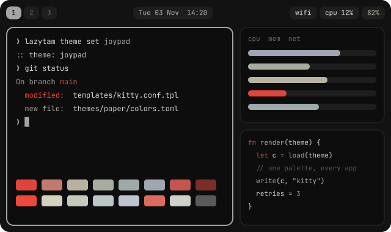
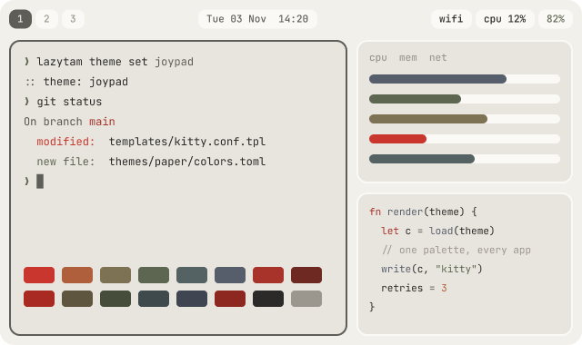

<picture>
  <source media="(max-width: 600px) and (prefers-color-scheme: light)" srcset="docs/assets/header-light.m.svg">
  <source media="(max-width: 600px)" srcset="docs/assets/header.m.svg">
  <source media="(prefers-color-scheme: light)" srcset="docs/assets/header-light.svg">
  
</picture>

<p align="center">
  <a href="#install">Install</a> ·
  <a href="#everyday-use">Everyday use</a> ·
  <a href="#themes">Themes</a> ·
  <a href="docs/architecture.md">How it works</a> ·
  <a href="docs/roadmap.md">Roadmap</a> ·
  <a href="CONTRIBUTING.md">Contributing</a>
</p>

lazytam turns a fresh Arch install into a finished Hyprland desktop and coding box:
defaults that look good, one command for themes and updates, and nothing you didn't ask
for. Unlike bigger frameworks, it never owns your config. Its defaults load first, your
files load last, and updates only ever touch lazytam's own folder.

## Why lazytam

| | |
|---|---|
| **Your files stay yours** | `~/.config/hypr/hyprland.conf` and friends are yours. They load lazytam's defaults, then your overrides. Updates never write to them. |
| **Swap anything** | Terminal, launcher, browser, editor, file manager: one line each in `~/.config/lazytam/config.toml`. |
| **Nothing you didn't ask for** | Modules list every package they install. No Chromium, no bundled apps to remove. TUIs first. |
| **Themes are just colors** | One `colors.toml` recolors Hyprland, Waybar, kitty, the lock screen, fuzzel, mako, btop and tmux. Omarchy themes drop straight in. |

## Install

On a fresh Arch install, as your normal user (not root):

```bash
git clone https://github.com/tam11a/lazytam ~/.local/share/lazytam
```

```bash
bash ~/.local/share/lazytam/install.sh --profile laptop-server
```

The repo is private for now, so log in first (`gh auth login`) or clone over SSH.

| Profile | Modules | For |
|---|---|---|
| `laptop` | core dev desktop laptop | A laptop you sit at |
| `laptop-server` *(default)* | core dev desktop laptop server | A laptop that also stays on for SSH |
| `desktop` | core dev desktop | A desktop PC |
| `server` | core dev server | A headless box you reach over SSH |

The profile only seeds `~/.config/lazytam/config.toml` on the first run. To change modules
later, edit `modules` there and run `install.sh` again. It's safe to run any number of times.

When it finishes, open a new shell, run `lazytam doctor`, and start the desktop from a TTY
with `uwsm start hyprland.desktop`.

## Everyday use

```
lazytam theme list | set <name> | pick | install <git-url> | render
lazytam bg next | apply          # cycle or re-apply the theme's wallpapers
lazytam launch tui <cmd>         # open a TUI in your configured terminal
lazytam update                   # pull lazytam, run migrations, upgrade the system
lazytam doctor                   # check config, packages and starter files
lazytam config <key>             # print a config value
```

| Keys | Does |
|---|---|
| `Super` `Return` / `Space` / `B` / `E` | Terminal / launcher / browser / file manager |
| `Super` `Q` · `F` · `V` · `T` | Close · fullscreen · float · toggle split |
| `Super` `H J K L` (+`Shift` to move) | Focus (move) windows |
| `Super` `1`–`9` (+`Shift`) | Switch to (move to) workspace |
| `Super` `S` | Scratchpad |
| `Super` `Ctrl` `T` · `W` · `V` | Theme picker · next wallpaper · clipboard history |
| `Super` `Esc` · `Print` | Lock · screenshot region to clipboard |

The full list is in [`defaults/hypr/binds.conf`](defaults/hypr/binds.conf). Override any of
them in your own `~/.config/hypr/hyprland.conf`.

## Themes

<table>
  <tr>
    <td width="50%"></td>
    <td width="50%"></td>
  </tr>
  <tr>
    <td><b>joypad</b> (default). Charcoal and controller grays with one red button.</td>
    <td><b>paper</b>. joypad's light twin: ink on off-white, the same single red.</td>
  </tr>
</table>

Switch with `lazytam theme set paper`, or press `Super` `Ctrl` `T`. Both themes ship with
the `afk` and `lives` wallpapers.

Any [Omarchy](https://omarchy.org) theme works. For example, bjarneo's NES theme, which
inspired joypad:

```bash
lazytam theme install https://github.com/bjarneo/omarchy-nes-theme
```

Installed themes are copied to `~/.config/lazytam/themes/`, so they keep working even if
their repo disappears. To make your own, see [docs/themes.md](docs/themes.md).

## How it fits together

```
~/.local/share/lazytam/        this repo. Never edit; `lazytam update` pulls it
~/.config/lazytam/
├── config.toml                yours: modules, theme, font, apps
├── themes/                    themes you installed
├── defaults -> ~/.local/share/lazytam/defaults
└── current/                   rendered by `lazytam theme`: app list + theme colors
~/.config/hypr/hyprland.conf   yours: loads current/apps.conf, defaults, theme, then you
```

[docs/architecture.md](docs/architecture.md) walks through install, rendering and updates.
[docs/modules.md](docs/modules.md) covers what each module does and how to write one.

## Develop and contribute

```bash
make test      # unit tests + CLI run in a throwaway HOME
make lint      # bash -n and shellcheck
make arch      # full install in an Arch container (needs Docker)
make readme    # rebuild the animated README headers
```

You don't need Arch to work on lazytam: the tests run on any Linux or WSL with Python 3.11+.
Read [CONTRIBUTING.md](CONTRIBUTING.md) before your first pull request. If you use
Claude Code, [CLAUDE.md](CLAUDE.md) gives it the project's rules and layout.

The plan lives in [docs/](docs/README.md): the [vision](docs/vision.md),
[requirements](docs/requirements.md) with IDs and status, the [roadmap](docs/roadmap.md),
and a record of every [decision](docs/decisions/README.md) so far.

## Status

lazytam is young. The theme engine, CLI and installer are tested in CI (including a full
install in an Arch container), but it hasn't had much time on real hardware yet. Expect
rough edges, and please [open an issue](../../issues/new/choose) when you hit one.

## Credits

- Brand, palettes and wallpaper sources live in the lazytam Figma file ([docs/brand.md](docs/brand.md)).
- joypad is inspired by [bjarneo's NES theme](https://github.com/bjarneo/omarchy-nes-theme), with its own colors.
- Theme format from [Omarchy](https://github.com/basecamp/omarchy).

## License

The code and docs are [MIT](LICENSE). The lazytam name, logo and wallpapers aren't: use
them with lazytam, but give a fork its own name and art. See
[using the brand](docs/brand.md#using-the-brand).
